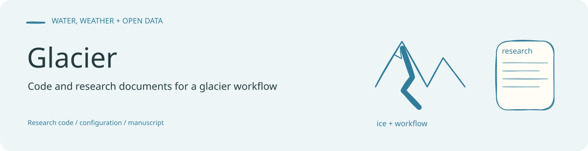
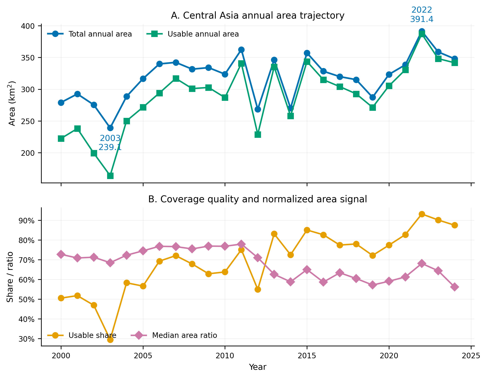

<!-- readme-visual-refresh:banner -->

<!-- /readme-visual-refresh:banner -->

# Glacier

Code and project documents for the Glacier workflow.

## Included in this repository

- `src/`
- `configs/`
- `notebooks/`
- `manuscript/`
- project documentation in the repository root

## Excluded from GitHub

Large datasets, logs, checkpoints, models, and generated figures are ignored via `.gitignore`.

<!-- readme-visual-refresh:artwork-source -->
[Editable banner artwork · Excalidraw](assets/readme/banner.excalidraw)
<!-- /readme-visual-refresh:artwork-source -->

<!-- readme-visual-refresh:selected-result -->

## 已有结果展示

已有图件：中亚 2000–2024 年湖泊面积序列，以及可用数据覆盖比例与归一化面积信号。 该图为仓库已有成果，保留原有来源；本次仅整理展示，未重新运行。 [查看来源](https://github.com/GISWLH/Glacier/blob/main/manuscript/figures_for_paper/rendered/central_asia_2000_2024_final/central_asia_2000_2024_final_figure01_year_overview.png)。

<!-- /readme-visual-refresh:selected-result -->
